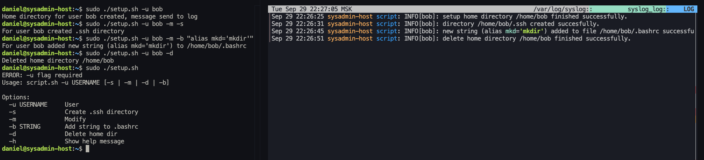

## М1/M2 setup script: Скрипт принимает аргумент (имя пользователя), создаёт домашнюю и .ssh директории, файл .bashrc, позволяет добавлять новые строки в файл .bashrc и записывает события в syslog.

## M3/M4 RAID + HTTP service:

### Runbook настройки модуля
1. Копируем репозиторий 
        
        git clone https://github.com/FawkesguyD/my-sysadmin-scripts.git
2.  Переходим в рабочую директорию

        cd my-sysadmin-scripts

3.  Выдаем права на исполнение для скрипта `bootstrap.sh`ё

        sudo chmod +x ./bootstrap.sh

4.  Запускаем скрипт

        sudo ./bootstrap.sh